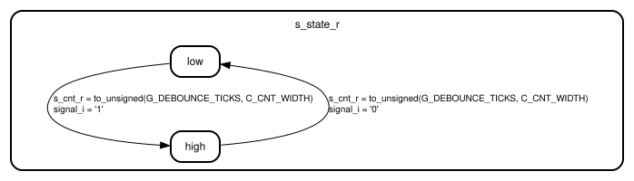

# Entity: debounce 
- **File**: debounce.vhd
- **Brief:**  Debounce / glitch filter for a single-bit input signal.

## Diagram

## Description

The output only follows the input after it has been stable at the
new level for G_DEBOUNCE_TICKS consecutive clock cycles. Any shorter pulse
resets the internal counter, so glitches are suppressed. The module can
also be used as a fixed delay element for slowly changing signals
(e.g. power-enable to power-good-release delays).

## Generics

| Generic name     | Type    | Value   | Description                                                                                                               |
| ---------------- | ------- | ------- | ------------------------------------------------------------------------------------------------------------------------- |
| G_DEBOUNCE_TICKS | integer | 1000000 | Number of consecutive stable clock cycles required before the output follows the input (1000000 ticks = 12.5 ms @ 80 MHz) |

## Ports

| Port name | Direction | Type      | Description                                                 |
| --------- | --------- | --------- | ----------------------------------------------------------- |
| clk_i     | in        | std_logic | System clock, rising edge active                            |
| signal_i  | in        | std_logic | Input signal to be debounced (may be asynchronous / bouncy) |
| signal_o  | out       | std_logic | Debounced output signal (registered, initial value '0')     |

## Signals

| Name      | Type                               | Description |
| --------- | ---------------------------------- | ----------- |
| s_state_r | t_state                            |             |
| s_cnt_r   | unsigned(C_CNT_WIDTH - 1 downto 0) |             |
| s_q_r     | std_logic                          |             |

## Constants

| Name        | Type    | Value                                           | Description |
| ----------- | ------- | ----------------------------------------------- | ----------- |
| C_CNT_WIDTH | natural | integer(ceil(log2(real(G_DEBOUNCE_TICKS + 1)))) |             |

## Enums

### *t_state*
| Name | Description |
| ---- | ----------- |
| low  |             |
| high |             |

## Processes
- fsm_proc: ( clk_i )

## State machines

