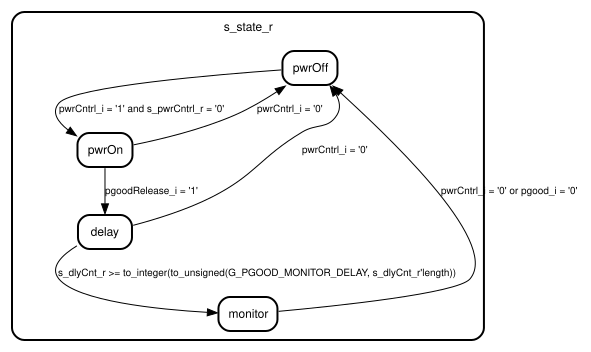

# Entity: fmcPowerCntrl 
- **File**: fmcPowerCntrl.vhd
- **Brief:**  FMC supply power-up controller and power-good supervisor.

## Diagram

## Description

FSM sequence: pwrOff -> pwrOn (rising edge of pwrCntrl_i enables the
supply) -> delay (entered when the MCU releases pgood via pgoodRelease_i;
waits G_PGOOD_MONITOR_DELAY ticks for the rail to rise) -> monitor
(pgood_i is supervised). A low level on pwrCntrl_i in any state, or a
loss of pgood_i in the monitor state, immediately returns the FSM to
pwrOff and disables the supply. While the supply is off or ramping,
pgood_oe is high so the open-drain pgood line is actively pulled low,
preventing a false power-good indication towards the FMC module.

## Generics

| Generic name          | Type    | Value | Description                                                                                                                             |
| --------------------- | ------- | ----- | --------------------------------------------------------------------------------------------------------------------------------------- |
| G_PGOOD_MONITOR_DELAY | natural | 8000  | Number of clock ticks to wait after pgood release before pgood is monitored (accounts for rail rise time, 8000 ticks = 100 us @ 80 MHz) |

## Ports

| Port name      | Direction | Type      | Description                                                                             |
| -------------- | --------- | --------- | --------------------------------------------------------------------------------------- |
| clk_i          | in        | std_logic | System clock, rising edge active                                                        |
| pwrCntrl_i     | in        | std_logic | Power control input from MCU (rising edge starts power-up, low = power off)             |
| pgoodRelease_i | in        | std_logic | Power good release input from MCU (high = monitor pgood, low = force pgood low)         |
| pgood_i        | in        | std_logic | Power good input from IO (synchronized supply power-good feedback)                      |
| pgood_oe       | out       | std_logic | Power good output enable to IO (high = drive pgood line low, low = tristate pgood line) |
| en_o           | out       | std_logic | Power enable output to IO (high = enable power, low = disable power)                    |

## Signals

| Name         | Type                                   | Description |
| ------------ | -------------------------------------- | ----------- |
| s_state_r    | t_state                                |             |
| s_dlyCnt_r   | unsigned(C_DELAY_CNT_WIDTH-1 downto 0) |             |
| s_pwrCntrl_r | std_logic                              |             |
| s_en         | std_logic                              |             |
| s_en_r       | std_logic                              |             |
| s_pgoodOe    | std_logic                              |             |
| s_pgoodOe_r  | std_logic                              |             |

## Constants

| Name              | Type    | Value                                                | Description |
| ----------------- | ------- | ---------------------------------------------------- | ----------- |
| C_DELAY_CNT_WIDTH | natural | integer(ceil(log2(real(G_PGOOD_MONITOR_DELAY + 1)))) |             |

## Enums

### *t_state*
| Name    | Description |
| ------- | ----------- |
| pwrOff  |             |
| pwrOn   |             |
| delay   |             |
| monitor |             |

## Processes
- unnamed: ( clk_i )
- unnamed: ( clk_i )

## State machines

