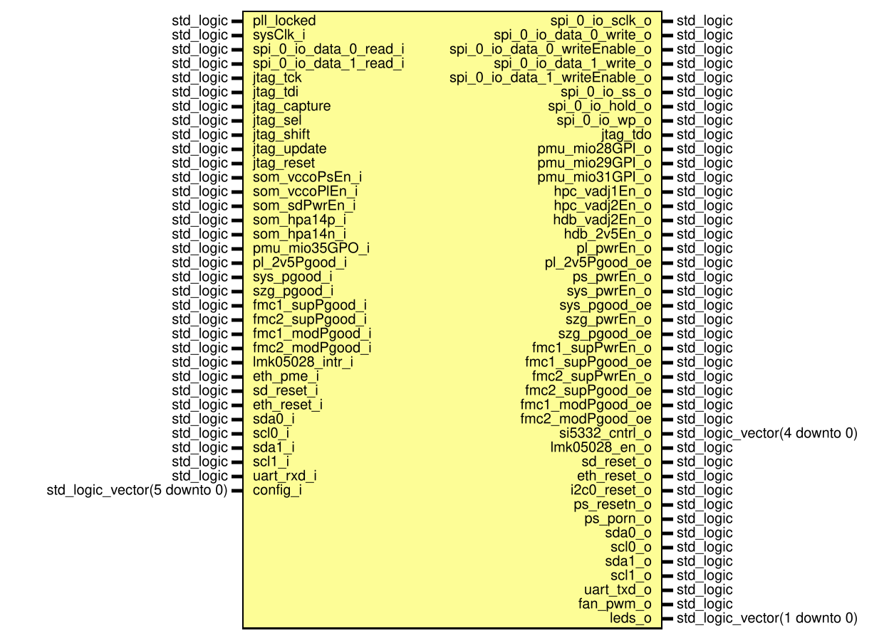

# Entity: sysCntrl_Top 
- **File**: sysCtnrl_top.vhd
- **Brief:**  System controller top level for the UNV baseboard (sysCntrl).

## Diagram

## Description

Instantiates the Sapphire SoC MCU and the board-level power sequencing
and supervision logic. All asynchronous board inputs are synchronized
(inputSync) and, where required, debounced before use. The design
controls the system / PL / PS / SYZYGY / FMC power rails, overrides
open-drain power-good lines while a rail is off (to avoid false
power-good indications), selects the HPC / HDB VCCIO rails via
break-before-make switches (vccioSelect), and generates the PS
power-on-reset and Ethernet PHY reset. MCU GPIO bank 1 carries the
control outputs, GPIO bank 0 reads back the synchronized status inputs.

## Ports

| Port name                     | Direction | Type                         | Description                                                                        |
| ----------------------------- | --------- | ---------------------------- | ---------------------------------------------------------------------------------- |
| pll_locked                    | in        | std_logic                    | PLL lock indicator (high = locked; low = async reset for the MCU)                  |
| sysClk_i                      | in        | std_logic                    | System clock input (80 MHz)                                                        |
| spi_0_io_sclk_o               | out       | std_logic                    | SPI serial clock output (MCU flash interface)                                      |
| spi_0_io_data_0_read_i        | in        | std_logic                    | SPI data line 0 input (MISO)                                                       |
| spi_0_io_data_0_write_o       | out       | std_logic                    | SPI data line 0 output (MOSI)                                                      |
| spi_0_io_data_0_writeEnable_o | out       | std_logic                    | SPI data line 0 output enable (tristate control)                                   |
| spi_0_io_data_1_read_i        | in        | std_logic                    | SPI data line 1 input (dual/quad mode)                                             |
| spi_0_io_data_1_write_o       | out       | std_logic                    | SPI data line 1 output (dual/quad mode)                                            |
| spi_0_io_data_1_writeEnable_o | out       | std_logic                    | SPI data line 1 output enable (tristate control)                                   |
| spi_0_io_ss_o                 | out       | std_logic                    | SPI slave select output (active low)                                               |
| spi_0_io_hold_o               | out       | std_logic                    | SPI HOLD# output (unused, tied high)                                               |
| spi_0_io_wp_o                 | out       | std_logic                    | SPI write protect output (unused, tied high)                                       |
| jtag_tck                      | in        | std_logic                    | JTAG test clock for MCU debug interface                                            |
| jtag_tdi                      | in        | std_logic                    | JTAG test data input                                                               |
| jtag_tdo                      | out       | std_logic                    | JTAG test data output                                                              |
| jtag_capture                  | in        | std_logic                    | JTAG capture-DR/IR state indicator                                                 |
| jtag_sel                      | in        | std_logic                    | JTAG IR/DR select (debug enable)                                                   |
| jtag_shift                    | in        | std_logic                    | JTAG shift-DR/IR state indicator                                                   |
| jtag_update                   | in        | std_logic                    | JTAG update-DR/IR state indicator                                                  |
| jtag_reset                    | in        | std_logic                    | JTAG test logic reset                                                              |
| som_vccoPsEn_i                | in        | std_logic                    | SoM VCCO_PS bank enable input (high = PS bank powered, gates PS power)             |
| som_vccoPlEn_i                | in        | std_logic                    | SoM VCCO_PL bank enable input (high = PL bank powered, gates PL power)             |
| som_sdPwrEn_i                 | in        | std_logic                    | SoM SD card power enable input (status only)                                       |
| som_hpa14p_i                  | in        | std_logic                    | SoM HPA14 differential GPIO input, positive leg (status only)                      |
| som_hpa14n_i                  | in        | std_logic                    | SoM HPA14 differential GPIO input, negative leg (status only)                      |
| pmu_mio35GPO_i                | in        | std_logic                    | PS PMU MIO35 GPO input to the system controller                                    |
| pmu_mio28GPI_o                | out       | std_logic                    | PMU MIO28 GPI output to the PS (tied low)                                          |
| pmu_mio29GPI_o                | out       | std_logic                    | PMU MIO29 GPI output to the PS (tied low)                                          |
| pmu_mio31GPI_o                | out       | std_logic                    | PMU MIO31 GPI output to the PS (tied low)                                          |
| hpc_vadj1En_o                 | out       | std_logic                    | HPC FMC VADJ1 rail enable output (selected via hpcVccioSelect)                     |
| hpc_vadj2En_o                 | out       | std_logic                    | HPC FMC VADJ2 rail enable output (selected via hpcVccioSelect)                     |
| hdb_vadj2En_o                 | out       | std_logic                    | HDB VADJ2 rail enable output (selected via hdbVccioSelect)                         |
| hdb_2v5En_o                   | out       | std_logic                    | HDB 2V5 rail enable output (selected via hdbVccioSelect)                           |
| pl_pwrEn_o                    | out       | std_logic                    | PL power enable output (sys_pgood and som_vccoPlEn)                                |
| pl_2v5Pgood_i                 | in        | std_logic                    | PL 2V5 power good input (open-drain line)                                          |
| pl_2v5Pgood_oe                | out       | std_logic                    | PL 2V5 power good output enable (high = drive line low while rail is off)          |
| ps_pwrEn_o                    | out       | std_logic                    | PS power enable output (sys_pgood and som_vccoPsEn)                                |
| sys_pwrEn_o                   | out       | std_logic                    | System power enable output (always enabled)                                        |
| sys_pgood_i                   | in        | std_logic                    | System power good input (open-drain line)                                          |
| sys_pgood_oe                  | out       | std_logic                    | System power good output enable (high = drive line low while rail is off)          |
| szg_pwrEn_o                   | out       | std_logic                    | SYZYGY power enable output (PL and PS power enabled)                               |
| szg_pgood_i                   | in        | std_logic                    | SYZYGY power good input (open-drain line)                                          |
| szg_pgood_oe                  | out       | std_logic                    | SYZYGY power good output enable (high = drive line low while rail is off)          |
| fmc1_supPwrEn_o               | out       | std_logic                    | FMC1 supply power enable output (MCU controlled via fmcPowerCntrl)                 |
| fmc1_supPgood_i               | in        | std_logic                    | FMC1 supply power good input (connected to PG_C2M on the board)                    |
| fmc1_supPgood_oe              | out       | std_logic                    | FMC1 supply power good output enable (high = drive PG_C2M low)                     |
| fmc2_supPwrEn_o               | out       | std_logic                    | FMC2 supply power enable output (MCU controlled via fmcPowerCntrl)                 |
| fmc2_supPgood_i               | in        | std_logic                    | FMC2 supply power good input (connected to PG_C2M on the board)                    |
| fmc2_supPgood_oe              | out       | std_logic                    | FMC2 supply power good output enable (high = drive PG_C2M low)                     |
| fmc1_modPgood_i               | in        | std_logic                    | FMC1 module power good input (PG_M2C, open-drain line)                             |
| fmc1_modPgood_oe              | out       | std_logic                    | FMC1 module power good output enable (high = drive PG_M2C low while supply is off) |
| fmc2_modPgood_i               | in        | std_logic                    | FMC2 module power good input (PG_M2C, open-drain line)                             |
| fmc2_modPgood_oe              | out       | std_logic                    | FMC2 module power good output enable (high = drive PG_M2C low while supply is off) |
| si5332_cntrl_o                | out       | std_logic_vector(4 downto 0) | Si5332 clock generator control pins (tied low)                                     |
| lmk05028_en_o                 | out       | std_logic                    | LMK05028 clock generator enable output (tied low)                                  |
| lmk05028_intr_i               | in        | std_logic                    | LMK05028 interrupt / status input                                                  |
| eth_pme_i                     | in        | std_logic                    | Ethernet PHY power management event input                                          |
| sd_reset_o                    | out       | std_logic                    | SD card reset output, high active (open drain in interface, tied low)              |
| sd_reset_i                    | in        | std_logic                    | Dummy input (not connected, avoids synthesis warnings for the open-drain IO)       |
| eth_reset_o                   | out       | std_logic                    | Ethernet PHY reset output, high active (open drain in interface, released by MCU)  |
| eth_reset_i                   | in        | std_logic                    | Dummy input (not connected, avoids synthesis warnings for the open-drain IO)       |
| i2c0_reset_o                  | out       | std_logic                    | I2C0 bus reset output, high active (tied low)                                      |
| ps_resetn_o                   | out       | std_logic                    | PS reset output, low active (tied high, not used)                                  |
| ps_porn_o                     | out       | std_logic                    | PS power-on-reset output, low active (HW delay AND MCU release)                    |
| sda0_i                        | in        | std_logic                    | I2C0 SDA input (bus read)                                                          |
| sda0_o                        | out       | std_logic                    | I2C0 SDA output (open-drain drive, inverted MCU output)                            |
| scl0_i                        | in        | std_logic                    | I2C0 SCL input (bus read / clock stretching)                                       |
| scl0_o                        | out       | std_logic                    | I2C0 SCL output (open-drain drive, inverted MCU output)                            |
| sda1_i                        | in        | std_logic                    | I2C1 SDA input (bus read)                                                          |
| sda1_o                        | out       | std_logic                    | I2C1 SDA output (open-drain drive, inverted MCU output)                            |
| scl1_i                        | in        | std_logic                    | I2C1 SCL input (bus read / clock stretching)                                       |
| scl1_o                        | out       | std_logic                    | I2C1 SCL output (open-drain drive, inverted MCU output)                            |
| uart_rxd_i                    | in        | std_logic                    | MCU console UART receive input                                                     |
| uart_txd_o                    | out       | std_logic                    | MCU console UART transmit output                                                   |
| fan_pwm_o                     | out       | std_logic                    | Fan PWM output (tied low)                                                          |
| config_i                      | in        | std_logic_vector(5 downto 0) | Board configuration strap inputs, active low (synchronized and debounced, 10 ms)   |
| leds_o                        | out       | std_logic_vector(1 downto 0) | User LEDs, active low (LED0 = MCU controlled, LED1 = off)                          |

## Signals

| Name                       | Type                          | Description |
| -------------------------- | ----------------------------- | ----------- |
| s_srst                     | std_logic                     |             |
| s_clk                      | std_logic                     |             |
| s_usrIntrA                 | std_logic                     |             |
| s_usrIntrB                 | std_logic                     |             |
| s_gpio0_wre                | std_logic_vector(31 downto 0) |             |
| s_gpio0_wr                 | std_logic_vector(31 downto 0) |             |
| s_gpio0_rd                 | std_logic_vector(31 downto 0) |             |
| s_gpio1_wre                | std_logic_vector(31 downto 0) |             |
| s_gpio1_wr                 | std_logic_vector(31 downto 0) |             |
| s_gpio1_rd                 | std_logic_vector(31 downto 0) |             |
| s_wd_hardPanic             | std_logic                     |             |
| s_inputs                   | std_logic_vector(20 downto 0) |             |
| s_inputs_sync              | std_logic_vector(20 downto 0) |             |
| s_som_vccoPsEn             | std_logic                     |             |
| s_som_vccoPlEn             | std_logic                     |             |
| s_som_sdPwrEn              | std_logic                     |             |
| s_som_hpa14p               | std_logic                     |             |
| s_som_hpa14n               | std_logic                     |             |
| s_pmu_mio35GPO             | std_logic                     |             |
| s_fmc1_supPgood            | std_logic                     |             |
| s_fmc1_supPgood_dlyd       | std_logic                     |             |
| s_fmc2_supPgood            | std_logic                     |             |
| s_fmc2_supPgood_dlyd       | std_logic                     |             |
| s_fmc1_modPgood            | std_logic                     |             |
| s_fmc2_modPgood            | std_logic                     |             |
| s_pl_2v5Pgood              | std_logic                     |             |
| s_sys_pgood                | std_logic                     |             |
| s_szg_pgood                | std_logic                     |             |
| s_lmk05028_intr            | std_logic                     |             |
| s_eth_pme                  | std_logic                     |             |
| s_config_sync              | std_logic_vector(5 downto 0)  |             |
| s_config                   | std_logic_vector(5 downto 0)  |             |
| s_ledCount_r               | unsigned(25 downto 0)         |             |
| s_sys_pwrEn                | std_logic                     |             |
| s_sys_pwrEn_dlyd           | std_logic                     |             |
| s_pl_pwrEn                 | std_logic                     |             |
| s_pl_pwrEn_dlyd            | std_logic                     |             |
| s_ps_pwrEn                 | std_logic                     |             |
| s_ps_pwrEn_dlyd            | std_logic                     |             |
| s_szg_pwrEn                | std_logic                     |             |
| s_szg_pwrEn_dlyd           | std_logic                     |             |
| s_porn                     | std_logic                     |             |
| s_eth_rstn                 | std_logic                     |             |
| s_mcu_hpc_VccioSelect      | std_logic                     |             |
| s_mcu_hdb_VccioSelect      | std_logic                     |             |
| s_mcu_fmc1_supCntrl        | std_logic                     |             |
| s_mcu_fmc2_supCntrl        | std_logic                     |             |
| s_mcu_fmc1_supPgoodRelease | std_logic                     |             |
| s_mcu_fmc2_supPgoodRelease | std_logic                     |             |
| s_mcu_fmc1_modCntrl        | std_logic                     |             |
| s_mcu_fmc2_modCntrl        | std_logic                     |             |
| s_mcu_porn                 | std_logic                     |             |
| s_mcu_eth_rstn             | std_logic                     |             |
| s_mcu_led                  | std_logic                     |             |
| s_i2c0_sda_out             | std_logic                     |             |
| s_i2c0_scl_out             | std_logic                     |             |
| s_i2c1_sda_out             | std_logic                     |             |
| s_i2c1_scl_out             | std_logic                     |             |

## Constants

| Name                | Type                          | Value           | Description |
| ------------------- | ----------------------------- | --------------- | ----------- |
| C_100US_DELAY_TICKS | integer                       | 8000            |             |
| C_1MS_DELAY_TICKS   | integer                       | 80000           |             |
| C_5MS_DELAY_TICKS   | integer                       | 400000          |             |
| C_10MS_DELAY_TICKS  | integer                       | 800000          |             |
| C_20MS_DELAY_TICKS  | integer                       | 1600000         |             |
| C_100MS_DELAY_TICKS | integer                       | 8000000         |             |
| C_SYNC_INPUTS_INIT  | std_logic_vector(20 downto 0) | (others => '0') |             |

## Processes
- unnamed: ( s_clk )

## Instantiations

- inputSync_inst: work.inputSync
- mcu_inst: mcu
- sysPwrEn_delay_inst: work.debounce
- plPwrEn_delay_inst: work.debounce
- hpcVccioSelect: work.vccioSelect
- hdbVccioSelect: work.vccioSelect
- fmc1PowerCntrl_inst: work.fmcPowerCntrl
- fmc1ModEn_delay_inst: work.debounce
- fmc2PowerCntrl_inst: work.fmcPowerCntrl
- fmc2ModEn_delay_inst: work.debounce
- szgPwrEn_delay_inst: work.debounce
- por_delay_inst: work.debounce
