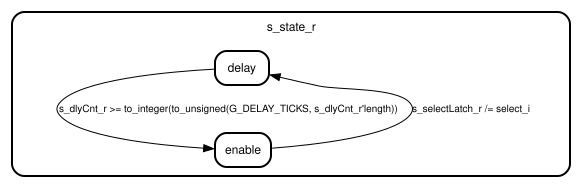

# Entity: vccioSelect 
- **File**: vccioSelect.vhd
- **Brief:**  Break-before-make selector between two VCCIO power rails.

## Diagram

## Description

Selects which of two mutually exclusive power rails is enabled
(select_i = '0' -> en1_o, select_i = '1' -> en2_o). On every change of
select_i both enables are deasserted for G_DELAY_TICKS clock cycles
before the newly selected rail is enabled, so the two rails are never
active at the same time. After reset the module starts in the delay
state with both rails disabled.

## Generics

| Generic name  | Type    | Value | Description                                                                                                                |
| ------------- | ------- | ----- | -------------------------------------------------------------------------------------------------------------------------- |
| G_DELAY_TICKS | natural | 80000 | Number of clock ticks with both rails disabled during a switch-over (break-before-make delay, 80000 ticks = 1 ms @ 80 MHz) |

## Ports

| Port name | Direction | Type      | Description                                                                      |
| --------- | --------- | --------- | -------------------------------------------------------------------------------- |
| clk_i     | in        | std_logic | System clock, rising edge active                                                 |
| select_i  | in        | std_logic | Rail select input ('0' = enable rail 1 via en1_o, '1' = enable rail 2 via en2_o) |
| en1_o     | out       | std_logic | Enable output for VCCIO rail 1 (high = enable power, low = disable power)        |
| en2_o     | out       | std_logic | Enable output for VCCIO rail 2 (high = enable power, low = disable power)        |

## Signals

| Name            | Type                                   | Description |
| --------------- | -------------------------------------- | ----------- |
| s_state_r       | t_state                                |             |
| s_dlyCnt_r      | unsigned(C_DELAY_CNT_WIDTH-1 downto 0) |             |
| s_selectLatch_r | std_logic                              |             |
| s_en1_r         | std_logic                              |             |
| s_en2_r         | std_logic                              |             |

## Constants

| Name              | Type    | Value                                        | Description |
| ----------------- | ------- | -------------------------------------------- | ----------- |
| C_DELAY_CNT_WIDTH | natural | integer(ceil(log2(real(G_DELAY_TICKS + 1)))) |             |

## Enums

### *t_state*
| Name   | Description |
| ------ | ----------- |
| delay  |             |
| enable |             |

## Processes
- unnamed: ( clk_i )

## State machines

